# Rapport de TP : Configuration et utilisation de Remote Desktop Protocol (RDP)

**École Supérieure Polytechnique de Dakar (ESP) – UCAD**
DGI-ESP · L3 GLSI · Services Réseaux Avancés · Année universitaire 2026-2027
**Enseignant :** Dr. GUEYE

| Réalisé par                             |
| --------------------------------------- |
| Nom et prénom : FATOUMATA BINTOU TRAORE |
| Nom et prénom : MOUSSA SIDIME           |

---

## Objectif

Configurer et utiliser RDP pour accéder à distance à un ordinateur Windows, depuis un client Windows puis un client Linux, et pour accéder à une machine virtuelle VirtualBox.

## Environnement de travail

| Rôle              | Machine                          | Détails                                   |
| ----------------- | -------------------------------- | ----------------------------------------- |
| Serveur RDP       | Windows 11 Professionnel (26H2)  | Nom du PC : MSA, compte : msasimsasidd    |
| Client Windows    | Connexion Bureau à distance      | Serveur 172.20.10.3, utilisateur aicha    |
| Client Linux      | Ubuntu avec Remmina              | Serveur 192.168.1.199, utilisateur fatima |
| Machine virtuelle | Ubuntu sous VirtualBox (msa-sid) | Accès RDP sur le port 3390                |

# Partie 1 : Activer le Bureau à distance sur le serveur Windows

### 1. Vérification de la version de Windows

La capture montre l'édition **Windows 11 Professionnel**, compatible.

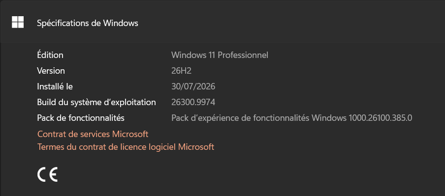

### 2. Activation du Bureau à distance

Dans _Paramètres > Système > Bureau à distance_, l'option est basculée sur **Activé**. Le nom du PC (**MSA**) est noté pour la connexion.

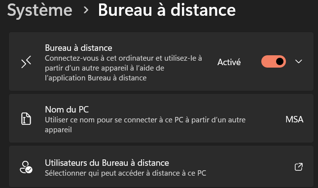

### 3. Accès des utilisateurs

Par défaut, seuls les administrateurs peuvent se connecter. Via _Utilisateurs du Bureau à distance > Ajouter_, le compte **msasid** a été creer puis autorisé ainsi on pourra se connecter a partir de ce compte .

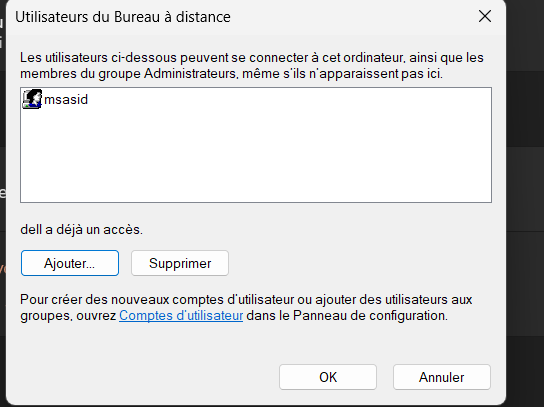

### 4. Pare-feu

Dans les applications autorisées du Pare-feu Windows Defender, les règles **Bureau à distance** et **Bureau à distance (WebSocket)** sont cochées.

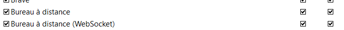

# Partie 2 : Connexion depuis un client Windows

Sur le client, l'outil **Connexion Bureau à distance** est lancé (commande `mstsc`). Dans l'onglet _Général_, on renseigne l'adresse du serveur (**172.20.10.3**) et le nom d'utilisateur (**aicha**), puis on clique sur _Connexion_ et on saisit le mot de passe.

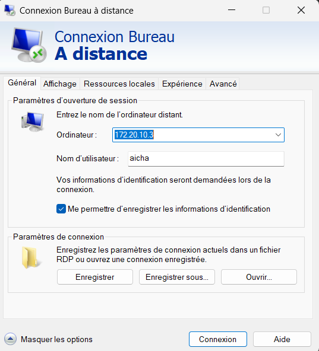

Les options permettent d'ajuster la connexion : onglet _Affichage_ (taille de l'écran en plein écran, couleurs en qualité optimale 32 bits) et onglet _Ressources locales_ (partage des imprimantes et du presse-papiers).

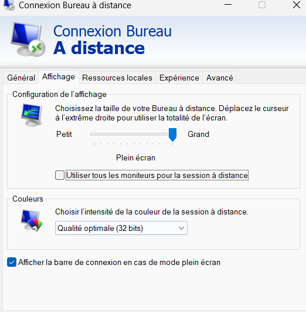

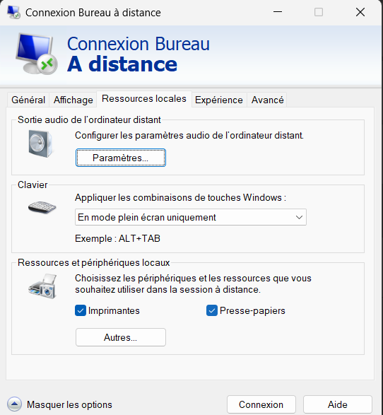

La connexion aboutit : le bureau du serveur s'affiche sur le client et se pilote comme si on était devant la machine.

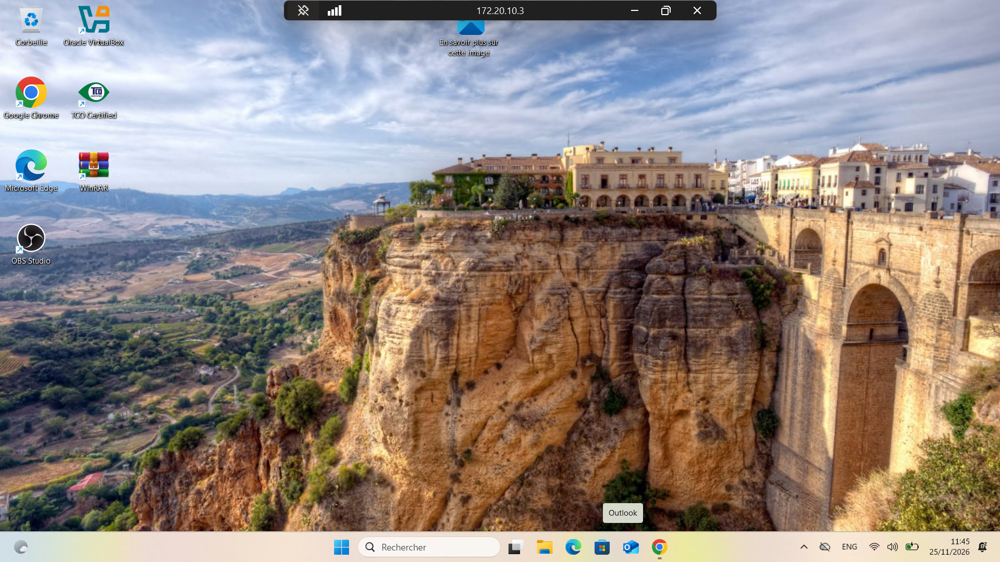

# Partie 3 : Connexion depuis un client Linux

### 1. Installation de Remmina

Sur Ubuntu, le client Remmina et son plugin RDP sont installés :

```bash
sudo apt update
sudo apt install remmina remmina-plugin-rdp
```

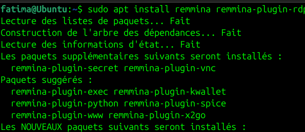

### 2. Configuration de la connexion

Dans Remmina, une nouvelle connexion est créée avec le protocole **RDP**. On renseigne le serveur (**192.168.1.199**), l'utilisateur (**msasid**) et le mot de passe, puis on clique sur _Enregistrer et se connecter_.

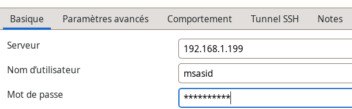

Au premier accès, Remmina affiche le certificat du serveur (CN = MSA) et demande de l'accepter.

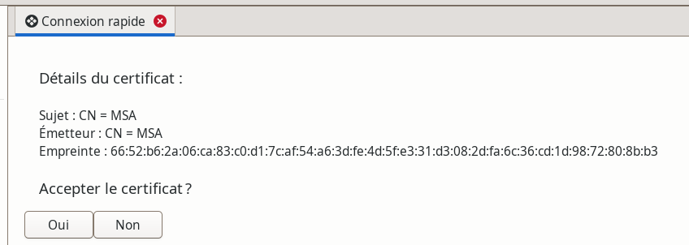

### 3. Test de la connexion

La session s'ouvre (écran « Bienvenue »), puis le bureau Windows apparaît. Le menu Démarrer s'ouvre et la commande `dir` exécutée dans l'invite de commandes affiche le contenu du dossier Bureau de l'utilisateur : le contrôle à distance fonctionne.

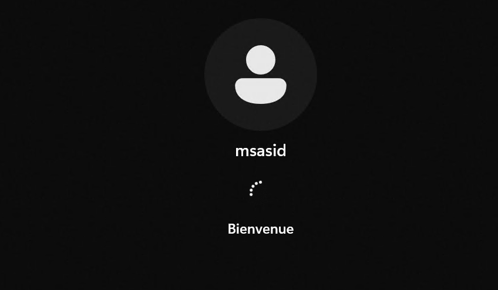

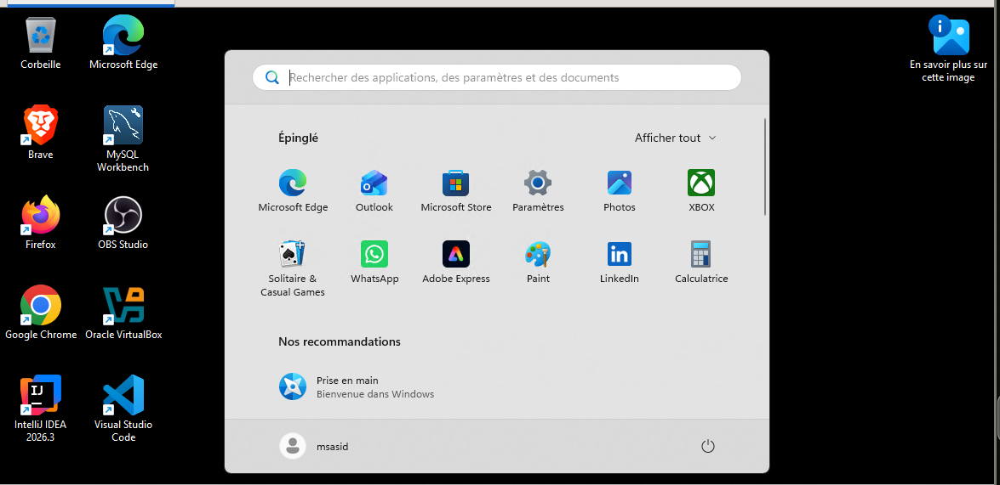


# Partie 4 : RDP sous VirtualBox

VirtualBox peut exposer une machine virtuelle en RDP. Comme Windows utilise déjà le port **3389**, le port **3390** a été attribué à la machine virtuelle.

Dans _Paramètres > Affichage > Bureau à distance_ de la VM : **Activer le serveur** coché, port **3390**, méthode d'authentification **Aucune**.

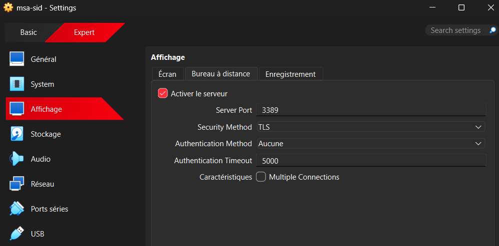

Les adresses IP relevées : la machine physique est en **192.168.1.198** et la VM en **10.0.2.15** (réseau NAT).

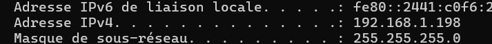

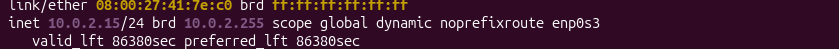

Une fois la VM démarrée, on lance Connexion Bureau à distance en indiquant `127.0.0.1:3390` (test réalisé en local). Un avertissement sur l'identité de l'ordinateur distant apparaît : on clique sur _Oui_.

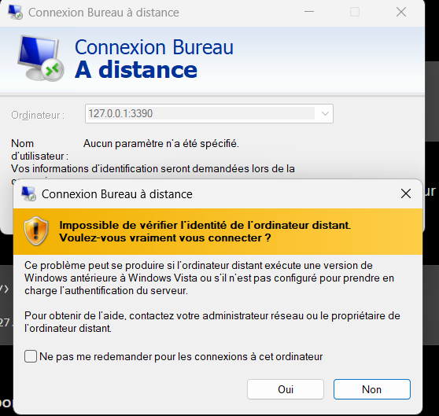

La session de la VM s'affiche dans la fenêtre RDP. Les commandes `sudo systemctl restart xrdp`, `sudo loginctl list-sessions` (2 sessions listées) ayant été executer elles apparaissent, les commandes `ls` puis `mkdir connecter` y sont exécutées.

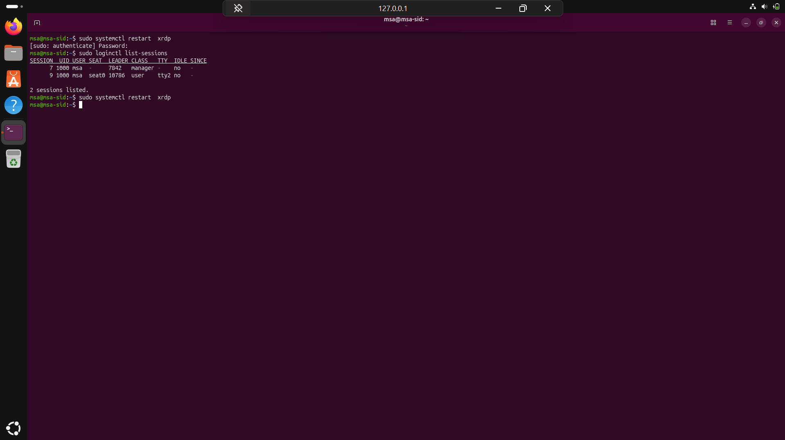

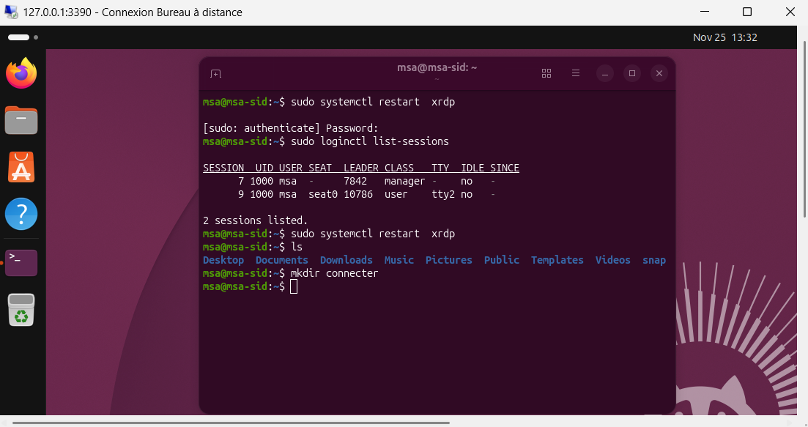

Les mêmes commandes apparaissent dans la fenêtre VirtualBox de la machine virtuelle, ce qui confirme que l'accès à distance contrôle bien la VM.

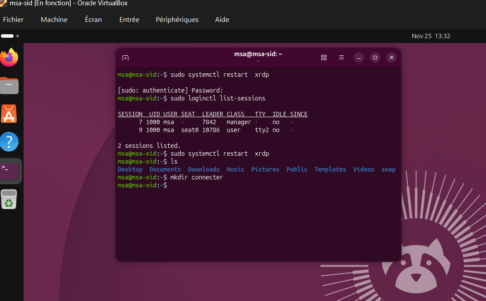

## Conclusion

Ce TP a permis d'activer le Bureau à distance sur un Windows 11 Pro, d'autoriser un utilisateur et de vérifier le pare-feu, puis de s'y connecter depuis un client Windows et un client Linux (Remmina). Il a aussi montré comment donner un accès RDP à une machine virtuelle VirtualBox, en choisissant un port différent (3390) pour éviter le conflit avec le port 3389 de Windows.
