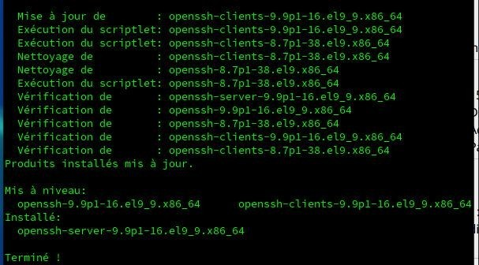
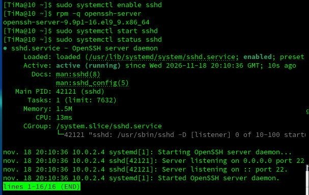
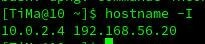
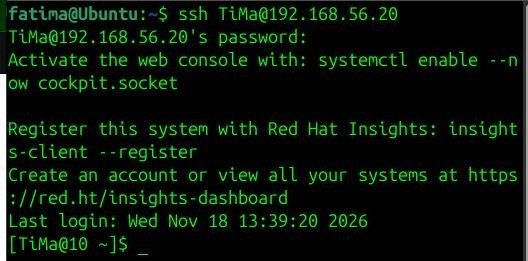
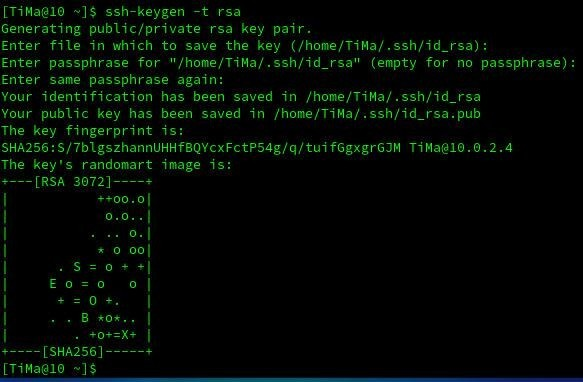
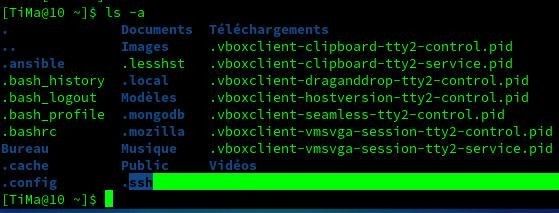
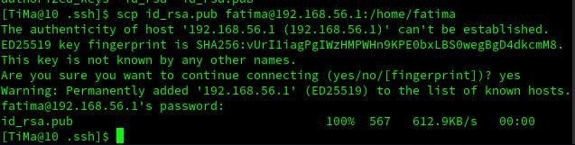
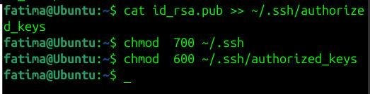
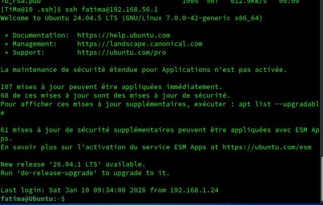
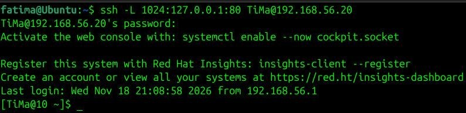

# Rapport de TP : Mise en place du protocole SSH

Matière : Services Réseaux Avancés

| Réalisé par   |                         |
| ------------- | ----------------------- |
| Nom et prénom | Fatoumata Bintou TRAORE |
| Nom et prénom | Moussa SIDIME           |

**Enseignant :** Dr. GUEYE

---

## Objectif

Ce TP a pour but de comprendre comment utiliser le protocole SSH pour sécuriser l'accès à une machine distante : installation du serveur, connexion depuis un client, authentification par clés et création d'un tunnel.

## Environnement de travail

Le TP a été réalisé avec deux machines reliées en réseau local :

| Machine            | Système                | Adresse IP    | Rôle        |
| ------------------ | ---------------------- | ------------- | ----------- |
| Machine 1 (TiMa)   | Linux (famille RHEL 9) | 192.168.56.20 | Serveur SSH |
| Machine 2 (fatima) | Ubuntu 24.04.5 LTS     | 192.168.56.1  | Client SSH  |

---

## 1. Installation du serveur SSH

Sur la machine serveur, le paquet `openssh-server` a été installé puis le service `sshd` activé au démarrage et lancé. La distribution étant de la famille RHEL, les commandes utilisées sont celles de `dnf` et de `sshd` à la place de `apt` et de `ssh` :

```bash
sudo dnf install openssh-server
sudo systemctl enable sshd
sudo systemctl start sshd
sudo systemctl status sshd
```


_Figure 1 : Installation d'openssh-server (version 9.9p1)_

La commande `rpm -q openssh-server` confirme la présence du paquet. Le statut du service indique « active (running) » et « enabled » : `sshd` est donc lancé et démarrera automatiquement.


_Figure 2 : Activation, démarrage et statut du service sshd_

On vérifie ensuite que le port 22 est ouvert. La commande `netstat` montre `sshd` en écoute (LISTEN) sur `0.0.0.0:22` en IPv4 et sur `:::22` en IPv6.

```bash
netstat -anp | grep -w 22
```


_Figure 3 : Port 22 en écoute_

L'adresse IP du serveur est obtenue avec la commande `hostname -I`. Celle utilisée pour la liaison avec le client est `192.168.56.20` (l'adresse `10.0.2.4` correspond à l'interface NAT de la machine virtuelle).


_Figure 4 : Adresses IP du serveur_

---

## 2. Connexion SSH depuis le client

Depuis la machine cliente (Ubuntu), on se connecte au serveur avec l'utilisateur `TiMa` et l'adresse IP du serveur. Après saisie du mot de passe, le prompt du serveur s'affiche : la connexion est établie.

```bash
ssh TiMa@192.168.56.20
```


_Figure 5 : Connexion SSH du client vers le serveur_

---

## 3. Configuration des clés SSH

### Génération de la paire de clés

Sur le serveur, une paire de clés RSA (3072 bits) est générée avec `ssh-keygen`. Les fichiers sont enregistrés par défaut dans `/home/TiMa/.ssh`.

```bash
ssh-keygen -t rsa
```


_Figure 6 : Génération de la paire de clés RSA_

### Vérification

La commande `ls -a` fait apparaître le dossier `.ssh`. Son contenu comprend la clé privée `id_rsa`, la clé publique `id_rsa.pub` et le fichier `authorized_keys`.


_Figure 7 : Présence du dossier .ssh_


_Figure 8 : Contenu du dossier .ssh_

### Envoi de la clé publique

La clé publique est copiée depuis le serveur vers le répertoire `/home/fatima` de la machine cliente avec `scp`. À la première connexion, l'empreinte de l'hôte est acceptée (`yes`), puis le mot de passe de `fatima` est demandé. Le transfert atteint 100 % (567 octets).

```bash
scp id_rsa.pub fatima@192.168.56.1:/home/fatima
```


_Figure 9 : Envoi de la clé publique vers le client avec scp_

### Autorisation de la clé sur le client

Sur la machine cliente, la clé publique est ajoutée au fichier `authorized_keys`, puis les droits sont restreints : `700` sur le dossier `~/.ssh` et `600` sur `authorized_keys`. Ces droits sont nécessaires, sinon SSH refuse d'utiliser la clé.

```bash
cat id_rsa.pub >> ~/.ssh/authorized_keys
chmod 700 ~/.ssh
chmod 600 ~/.ssh/authorized_keys
```


_Figure 10 : Ajout de la clé publique et réglage des droits_

### Test de connexion

Depuis le serveur, la connexion vers le client s'effectue directement avec la commande ci-dessous. Aucun mot de passe n'est demandé : l'authentification par clé fonctionne.

```bash
ssh fatima@192.168.56.1
```


_Figure 11 : Connexion par clé, sans mot de passe_

---

## 4. Tunnel SSH en ligne de commande

Un tunnel SSH permet de faire transiter un autre protocole (HTTP, FTP, MySQL, etc.) à travers la connexion SSH chiffrée. Ici, le port local 1024 du client est redirigé vers le port 80 du serveur, via la commande suivante lancée depuis le client :

```bash
ssh -L 1024:127.0.0.1:80 TiMa@192.168.56.20
```

Après authentification, la session s'ouvre sur le serveur : le tunnel est établi. Tant que cette session reste ouverte, le service web du serveur (port 80) est accessible depuis le client à l'adresse <http://127.0.0.1:1024>.



_Figure 12 : Création du tunnel SSH (port local 1024 vers port 80)_

---

## Conclusion

Ce TP a permis de mettre en place un serveur SSH, de s'y connecter depuis un client, de configurer l'authentification par clés publique/privée pour se passer du mot de passe, et de créer un tunnel SSH pour faire passer un service par une connexion sécurisée.
