# Rapport de TP : Configuration et utilisation de VNC et NoVNC

**École Supérieure Polytechnique de Dakar (DGI-ESP / UCAD)**
Année universitaire 2026-2027
Licence 3 Génie Logiciel et Systèmes d'Information (L3 GLSI)

Matière : Services Réseaux Avancés

| Réalisé par   |                         |
| ------------- | ----------------------- |
| Nom et prénom | Fatoumata Bintou TRAORE |
| Nom et prénom | Moussa SIDIME           |

**Enseignant :** Dr. GUEYE

---

## Objectif

Ce TP a pour but de configurer un serveur VNC (TigerVNC) sur une machine Linux afin de prendre le contrôle de son bureau à distance depuis une machine cliente, de sécuriser cette connexion grâce à un tunnel SSH, puis de rendre ce même bureau accessible depuis un simple navigateur web grâce à noVNC. Le rapport couvre quatre parties : installation et configuration du serveur VNC, connexion depuis un client, sécurisation par tunnel SSH, et mise en place de noVNC.

## Environnement de travail

Le TP a été réalisé avec deux machines reliées en réseau local :

| Machine         | Système                              | Adresse IP    | Rôle        |
| --------------- | ------------------------------------ | ------------- | ----------- |
| Machine 1 (vm4) | Linux (famille RHEL 9), bureau XFCE  | 192.168.1.210 | Serveur VNC |
| Machine 2       | Windows (RealVNC Viewer, PowerShell) | 192.168.1.200 | Client VNC  |

Le serveur étant de la famille RHEL, les commandes `apt` du sujet sont remplacées par leurs équivalents `dnf`. Le serveur VNC utilise l'affichage `:1`, soit le port TCP 5901 (5900 + numéro d'affichage).

---

# Partie 1 : Installation et configuration du serveur VNC

### 1. Mise à jour de la machine

Le système est d'abord mis à jour (équivalent `dnf` de la commande `apt update && apt upgrade` du sujet) :

```bash
sudo dnf update -y
```

### 2. Installation du serveur VNC

TigerVNC est installé depuis les dépôts AppStream et BaseOS. La résolution des dépendances annonce l'installation de 7 paquets : `tigervnc-server` (1.13.1-8.el9) ainsi que ses dépendances `tigervnc-server-minimal`, `tigervnc-license`, `tigervnc-selinux`, `dbus-daemon`, `dbus-tools` et `dbus-x11`.

```bash
sudo dnf install tigervnc-server -y
```

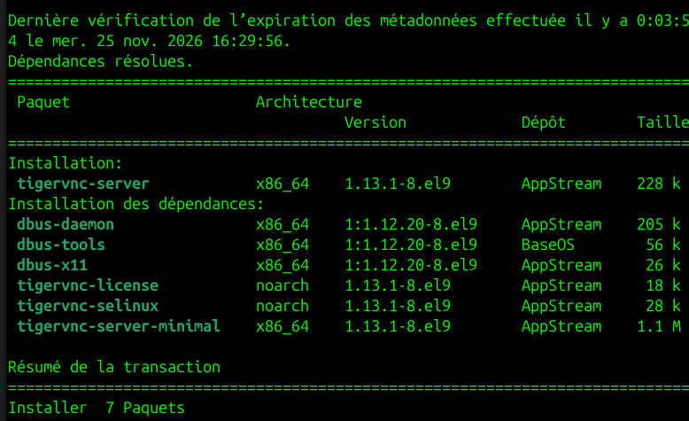

À la fin de la transaction, tous les paquets figurent dans la liste « Installé » et dnf affiche « Terminé ! ».

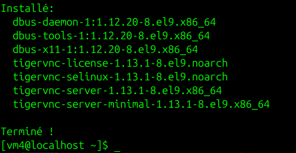

### 3. Configuration de l'environnement de bureau

Aucun environnement de bureau léger n'étant présent, XFCE est installé. La capture montre les derniers paquets installés (`xfce4-panel`, `xfce4-session`, `xfce4-terminal`, `xfwm4`, `xfdesktop`, `xfconf`, etc.), puis la fin de la transaction.

```bash
sudo dnf groupinstall "Xfce" -y
```

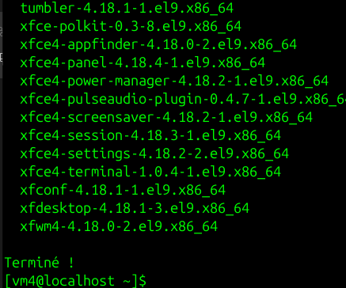

### 4. Initialisation du serveur VNC

Le serveur VNC est démarré sur l'affichage `:1`, ce qui correspond au port 5901. Le mot de passe VNC est demandé lors de la première exécution. Ici, le message indique qu'une session VNC tourne déjà sur `:1`. L'avertissement précise aussi que le script `vncserver` est déprécié sous RHEL 9 au profit d'une unité systemd, mais il reste utilisable pour ce TP.

```bash
vncserver :1
```

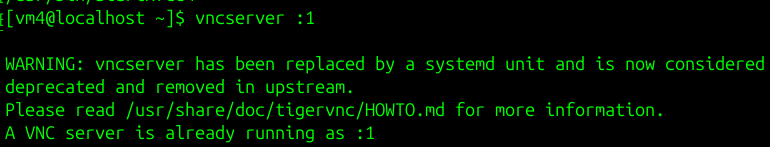

### 5. Arrêt du serveur pour la configuration avancée

Le serveur est arrêté afin de pouvoir modifier ses fichiers de démarrage. La commande termine le processus Xvnc (PID 33383).

```bash
vncserver -kill :1
```

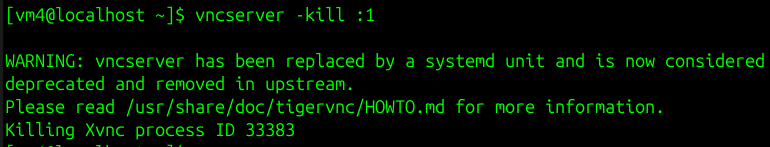

### 6. Personnalisation du fichier de configuration

Le fichier `~/.vnc/xstartup` est édité pour lancer XFCE à l'ouverture de la session :

```bash
#!/bin/bash
xrdb $HOME/.Xresources
startxfce4 &
```

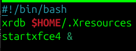

Le script est ensuite rendu exécutable :

```bash
chmod +x ~/.vnc/xstartup
```

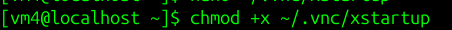

### 7. Relance du serveur VNC

Le serveur est relancé pour appliquer la configuration. La sortie indique la création du bureau `localhost.localdomain:1 (vm4)`, le démarrage des applications définies dans `/home/vm4/.vnc/xstartup` et l'emplacement du fichier de log.

```bash
vncserver :1
```

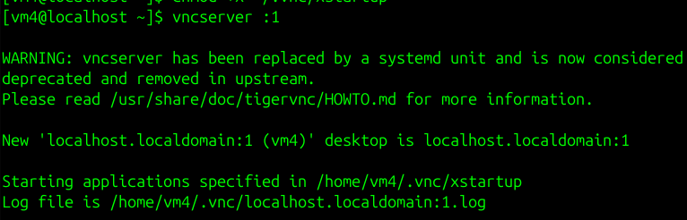

**Remarque.** Une session a également été lancée sur la machine Ubuntu : Xtigervnc écoute sur l'affichage `:2`, donc sur le port 5902. Cela confirme la règle « port = 5900 + numéro d'affichage ».

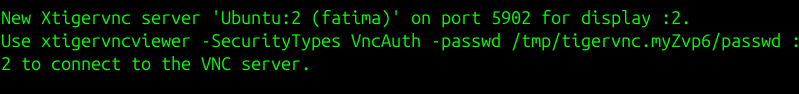

---

# Partie 2 : Connexion depuis une machine cliente

### 1. Installation du client VNC

Sur la machine cliente (Windows), le client **RealVNC Connect Viewer** est utilisé. Sa page d'accueil propose, dans la rubrique « Établir une connexion directe », un champ pour saisir l'adresse IP ou le nom d'hôte du serveur.

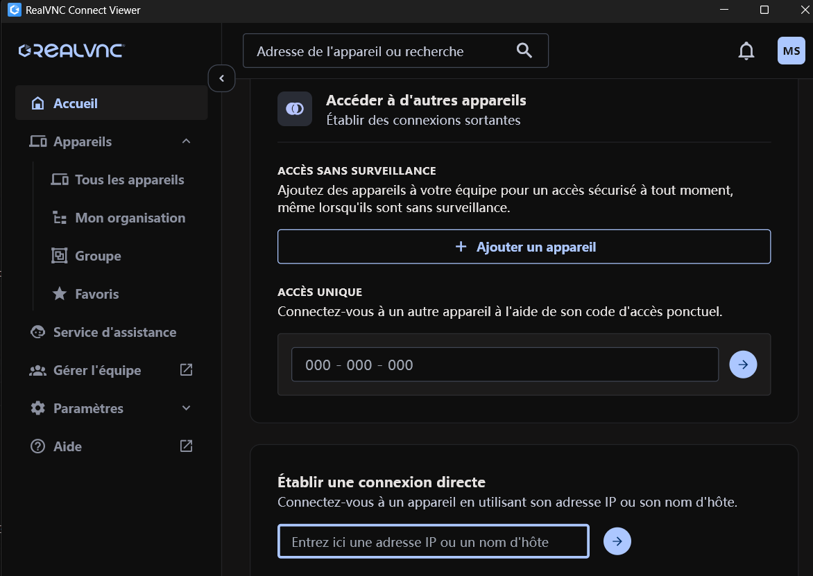

### 2. Connexion au serveur VNC

On saisit l'adresse du serveur, `192.168.1.210`, avec l'affichage 1 (port 5901). Le client affiche d'abord un écran de vérification : l'hôte est inconnu et la connexion ne sera pas chiffrée, car le protocole VNC n'est pas chiffré par défaut. On choisit « Continuer ».

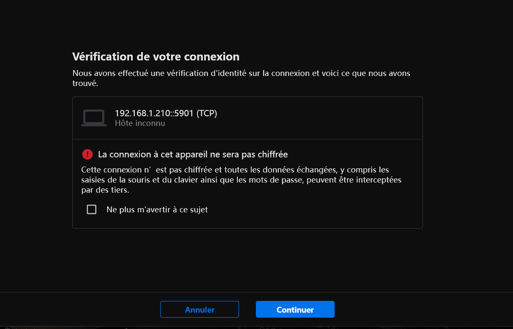

Le client demande ensuite le mot de passe défini lors de la configuration du serveur VNC (et non les identifiants du compte RealVNC).

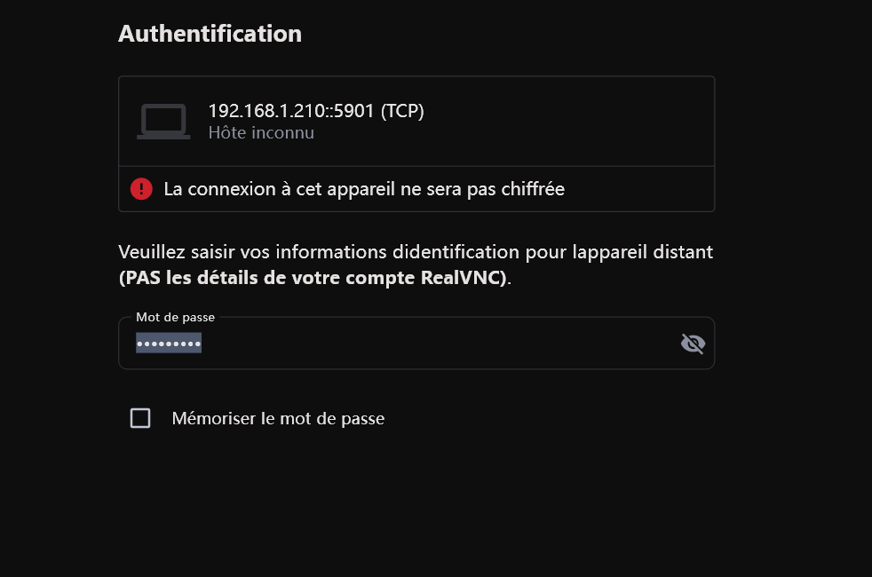

### 3. Test de la connexion

Une fois authentifié, le bureau XFCE du serveur s'affiche dans la fenêtre du client, avec la corbeille, le système de fichiers, le répertoire personnel et un dossier `TpVNC`. La barre de titre indique `192.168.1.210:1 (localhost.localdomain:1 (vm4))`.

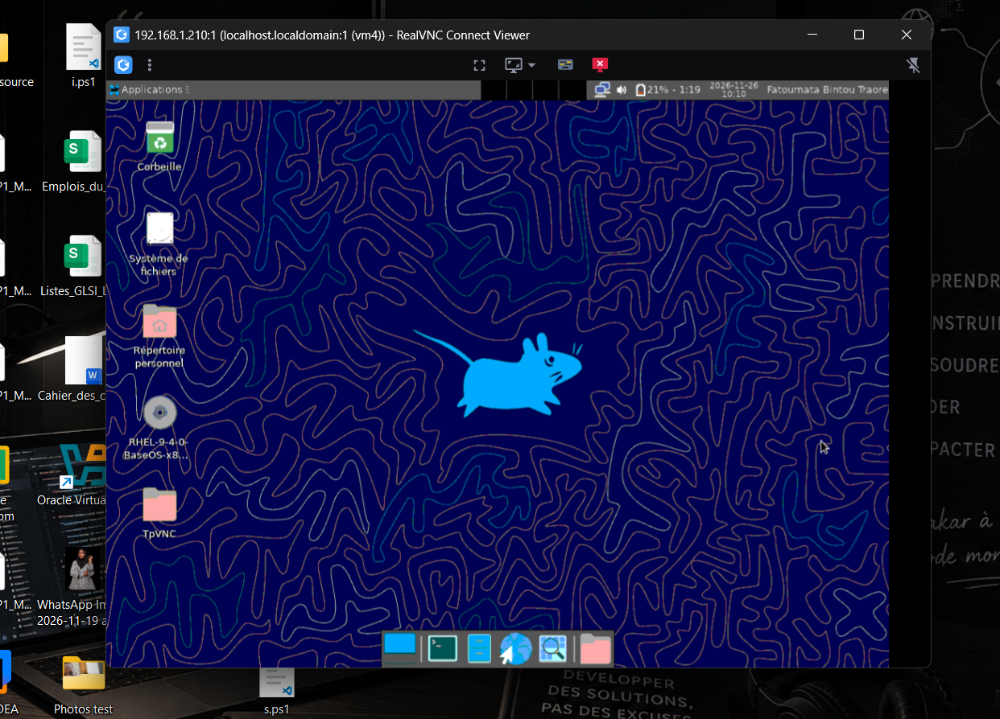

Pour tester les interactions, un terminal est ouvert dans la session VNC. On y crée un dossier `moussa`, un fichier `jemsuisconnecter`, on y écrit une ligne de texte puis on l'affiche :

```bash
ls
mkdir moussa
touch moussa/jemsuisconnecter
echo "Tache reussit" > moussa/jemsuisconnecter
cat moussa/jemsuisconnecter
```

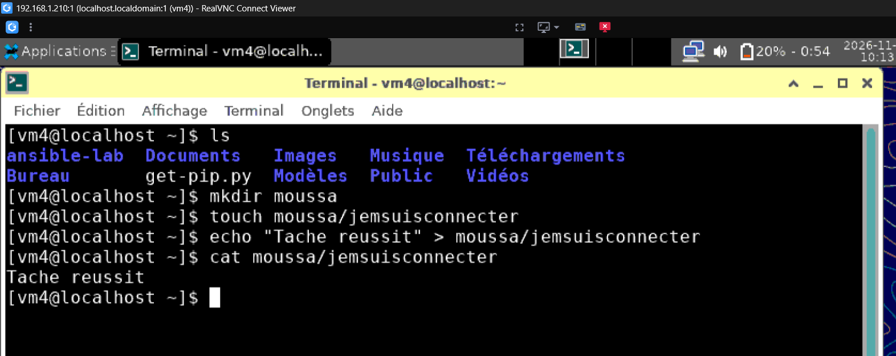

Pour confirmer que les actions ont bien été exécutées sur le serveur, on les vérifie directement dans le terminal de la machine serveur : le fichier est présent et son contenu est identique.

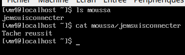

---

# Partie 3 : Sécurisation de la connexion VNC avec un tunnel SSH

### 1. Configuration du tunnel SSH

Sur la machine cliente, un tunnel SSH est ouvert depuis PowerShell. Il redirige le port local 5901 vers le port 5901 du serveur, à travers la connexion SSH chiffrée. À la première connexion, l'empreinte de l'hôte (ED25519) est acceptée (`yes`), puis le mot de passe de `vm4` est demandé. La session s'ouvre sur le serveur : le tunnel est établi et doit rester ouvert pendant toute l'utilisation de VNC.

```bash
ssh -L 5901:localhost:5901 vm4@192.168.1.210
```

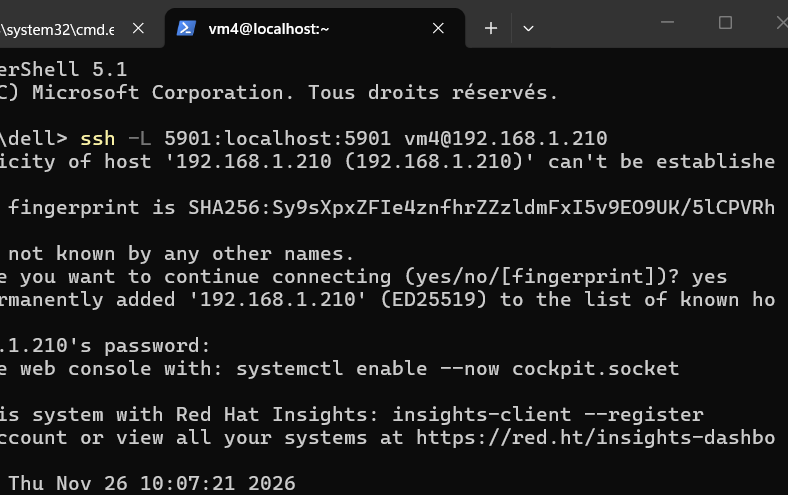

### 2. Connexion au serveur VNC via le tunnel

Dans RealVNC Viewer, on ne se connecte plus à l'adresse IP du serveur mais à `localhost:5901`. Le client envoie ainsi son trafic au port local, que SSH transporte jusqu'au serveur. Le message « La connexion à cet appareil ne sera pas chiffrée » reste affiché : il concerne le protocole VNC lui-même, alors que le chiffrement est assuré par le tunnel SSH.

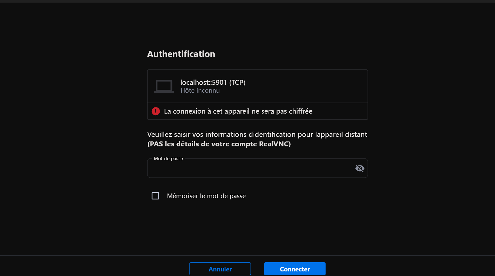

Après saisie du mot de passe VNC, la session du serveur s'affiche dans la fenêtre intitulée `localhost:5901 (localhost.localdomain:1 (vm4))`. La session étant verrouillée, l'écran de déverrouillage apparaît ; on saisit le mot de passe de l'utilisateur pour accéder au bureau.

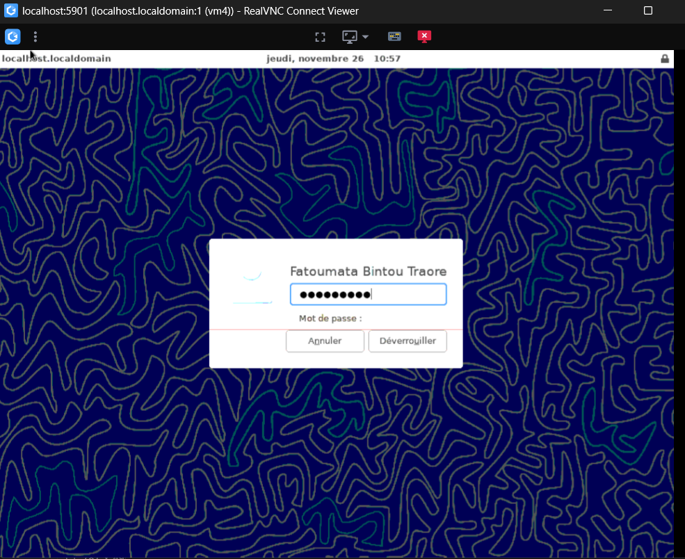

### 3. Vérification du chiffrement

Depuis le terminal de la session, on consulte le journal d'authentification du serveur avec `tail -f /var/log/secure` (car le serveur etant redhat le fichier de `/var/log/auth.log` est `/var/log/secure`). Sans privilèges, la lecture est refusée (« Permission non accordée ») ; avec `sudo`, le journal s'affiche. On y voit `sshd` en écoute sur le port 22 et des ouvertures de session pour l'utilisateur `vm4`, ce qui montre que l'accès passe bien par le service SSH.

```bash
tail -f /var/log/secure
sudo tail -f /var/log/secure
```

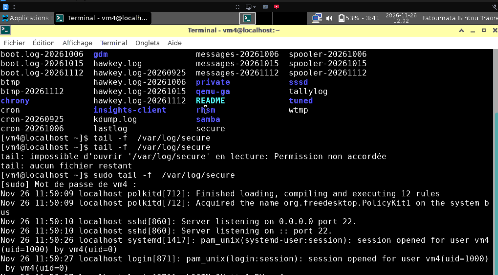

---

# Partie 4 : Mise en place d'un accès noVNC pour le contrôle à distance via un navigateur web

**Objectif :** donner accès au bureau du serveur VNC depuis un navigateur web, sans installer de client VNC sur la machine cliente.

**Principe :** un navigateur ne sait pas ouvrir une connexion TCP brute vers le port 5901 d'un serveur VNC. noVNC est donc un client VNC écrit en JavaScript/HTML5, et **websockify** fait le pont entre les WebSockets du navigateur et le port TCP du serveur VNC.

```
Navigateur (noVNC) <-- WebSocket (port 6080) --> websockify <-- TCP --> serveur VNC (localhost:5901)
```

**Remarque.** Dans cette partie, le nom d'hôte du serveur affiché dans le terminal et dans les messages de TigerVNC est `vbox` (par exemple `vm4@vbox`, `vbox:1`). Il s'agit de la même machine `vm4` (192.168.1.210) que dans les parties précédentes.

## Étape 1 : Installation du serveur VNC et de noVNC

### 1. Mise à jour du système

```bash
sudo dnf update -y
```

### 2. Installation du serveur VNC

TigerVNC a déjà été installé et configuré dans la partie 1 (`tigervnc-server`, bureau XFCE). Il n'est pas réinstallé ici.

### 3. Installation de noVNC

noVNC est récupéré depuis GitHub, dans `/opt`. L'outil `git` est d'abord installé. La capture montre les paquets installés (`git`, `git-core`, `git-core-doc`, `libcbor`, `libfido2`, `openssh-clients` et plusieurs modules `perl`), puis « Terminé ! ».

```bash
sudo dnf install git -y
```

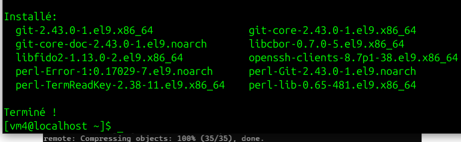

Le dépôt est ensuite cloné dans `/opt`. La capture montre le clonage en cours (comptage et compression des objets terminés, réception à 20 %).

```bash
cd /opt
sudo git clone https://github.com/novnc/noVNC.git
```

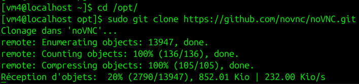

On se place dans le répertoire noVNC et on liste son contenu : on y trouve notamment les dossiers `app`, `core`, `docs`, `utils` et `vendor`, ainsi que les pages `vnc.html` et `vnc_lite.html`.

```bash
cd /opt/noVNC
ls
```

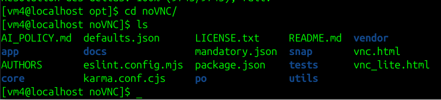

### 4. Installation de Websockify

Websockify est installé avec pip. On installe d'abord `python3-pip` (la capture montre l'installation de `python3-pip-21.2.3`), puis websockify.

```bash
sudo dnf install python3-pip -y
```

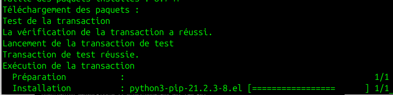

pip télécharge `websockify` (0.13.0) et ses dépendances (`redis`, `numpy`, etc.).

```bash
sudo pip3 install websockify
```

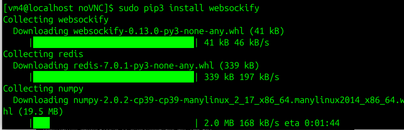

## Étape 2 : Configuration du serveur VNC

### 1. Lancer une session VNC

On démarre une session VNC sur l'affichage `:1` (port 5901). Le message indique qu'un serveur VNC tourne déjà sur `:1`, héritage de la partie 1. L'avertissement rappelle que le script `vncserver` est remplacé par une unité systemd sous RHEL 9.

```bash
vncserver :1
```

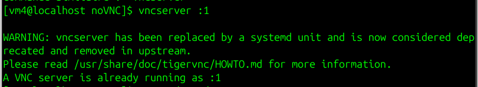

### 2. Configurer le fichier xstartup

Le fichier `~/.vnc/xstartup` est modifié pour lancer XFCE :

```bash
nano ~/.vnc/xstartup
```

```bash
#!/bin/bash
xrdb $HOME/.Xresources
startxfce4 &
```

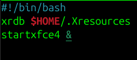

Le fichier est rendu exécutable :

```bash
chmod +x ~/.vnc/xstartup
```

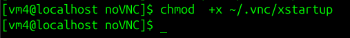

### 3. Redémarrer la session VNC

Pour appliquer la configuration, la session en cours est arrêtée avec `pkill Xvnc` (à la place de `vncserver -kill :1`, qui arrête le même processus), puis relancée. La sortie indique la création du bureau `vbox:1 (vm4)`, le démarrage des applications définies dans `/home/vm4/.vnc/xstartup` et le fichier de log `/home/vm4/.vnc/vbox:1.log`.

```bash
pkill Xvnc
vncserver :1
```

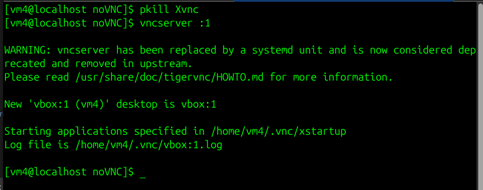

## Étape 3 : Lancer noVNC et configurer le service web

### 1. Lancer Websockify pour le tunneling

Le script `novnc_proxy` démarre à la fois un serveur web (qui distribue les fichiers noVNC) et le proxy WebSocket, en le faisant pointer vers le serveur VNC local :

```bash
cd /opt/noVNC
./utils/novnc_proxy --vnc localhost:5901
```

La sortie indique que websockify est trouvé dans `/usr/local/bin/websockify`, que le service écoute sur le port **6080**, que la racine web est `/opt/noVNC` et que le trafic est relayé de `:6080` vers `localhost:5901`. L'URL à ouvrir est affichée : `http://vbox:6080/vnc.html`.

Deux lignes méritent attention : « could not find self.pem » et « No SSL/TLS support (no cert file) ». Aucun certificat n'a été fourni, donc le service fonctionne en HTTP/WebSocket simple, sans chiffrement. C'est pourquoi la connexion est ensuite protégée par un tunnel SSH (étape 5).

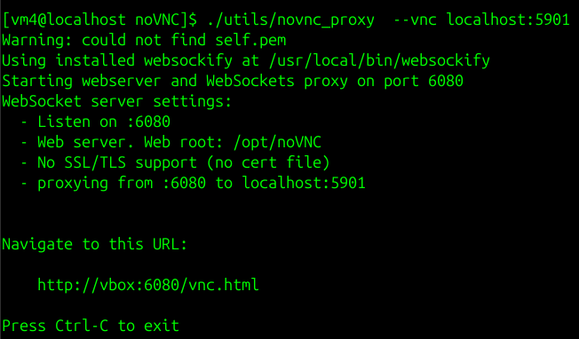

### 2. Accéder à noVNC via le navigateur

Le sujet indique l'adresse `http://ip_du_serveur:6080/vnc.html`. Lors du test, l'adresse a été saisie avec un espace avant le numéro de port (`http://192.168.1.210 :6080/vnc.html`) : Chrome ne l'a pas reconnue comme une URL et a lancé une recherche Google, dont les résultats n'ont aucun rapport avec noVNC. L'accès direct n'a donc pas abouti à ce stade ; on passe par le tunnel SSH de l'étape suivante, qui permet d'accéder à noVNC via `localhost`.

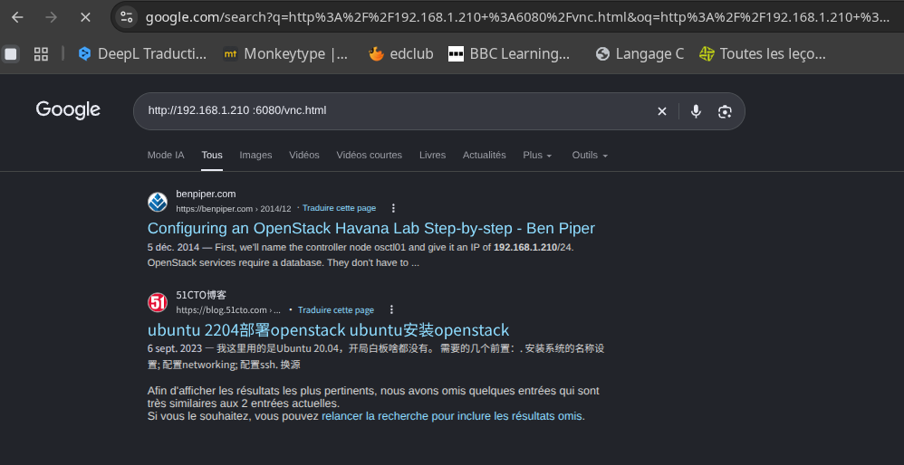

## Étape 5 : Sécuriser la connexion avec un tunnel SSH

Sur la machine cliente (PowerShell), on crée un tunnel qui redirige le port local 6080 vers le port 6080 du serveur :

```bash
ssh -L 6080:localhost:6080 vm4@192.168.1.210
```

Après saisie du mot de passe de `vm4`, la session s'ouvre sur le serveur (`[vm4@vbox ~]$`) : le tunnel est établi. Cette fenêtre doit rester ouverte pendant toute l'utilisation de noVNC.

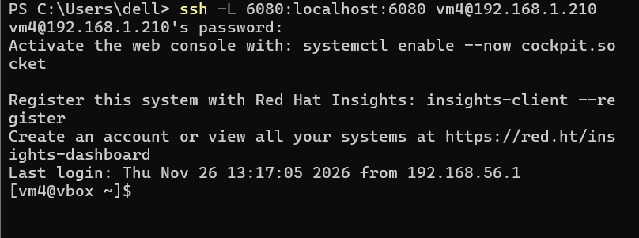

On ouvre ensuite dans le navigateur `http://localhost:6080/vnc.html`. La page d'accueil de noVNC s'affiche, avec le bouton « Connecter » :

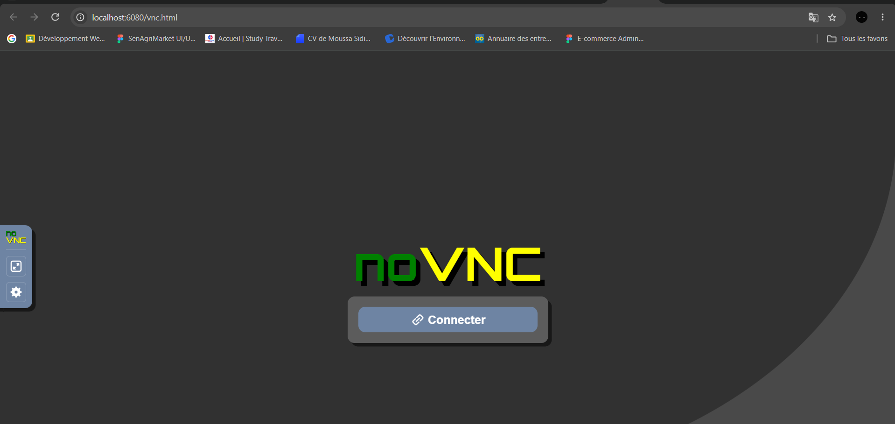

## Étape 6 : Tests et vérification

### 1. Connexion VNC

Après un clic sur « Connecter » et la saisie du mot de passe VNC, le bureau du serveur s'affiche dans l'onglet du navigateur. La session étant verrouillée (barre du haut intitulée `vbox`), l'écran de déverrouillage apparaît : on saisit le mot de passe de l'utilisateur.

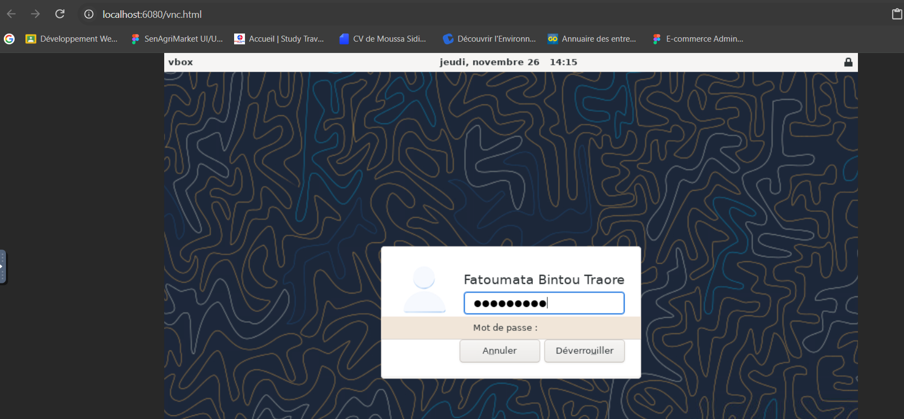

Une fois la session déverrouillée, on ouvre un terminal dans `/opt/noVNC` et on teste le clavier : `ls` affiche le contenu du répertoire, puis la touche de tabulation complète les noms de fichiers (`cat app/` et `cat A` proposent les fichiers du dossier, dont `AI_POLICY.md` et `AUTHORS`). Le bureau XFCE répond donc normalement depuis le navigateur, sans client VNC installé sur la machine cliente.

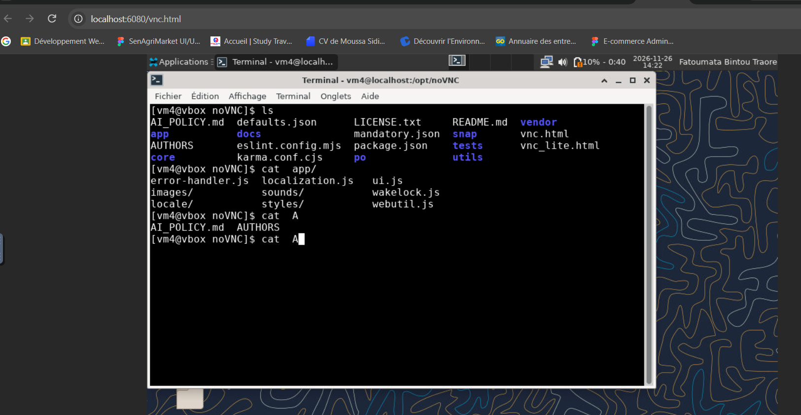

### 2. Stabilité du service (redémarrage de la machine)

**Constat.** Après le redémarrage, le test n'a pas fonctionné : la page `http://localhost:6080/vnc.html` n'était plus accessible et il n'était plus possible d'ouvrir le bureau depuis le navigateur. VNC et noVNC ne se sont donc pas relancés tout seuls.
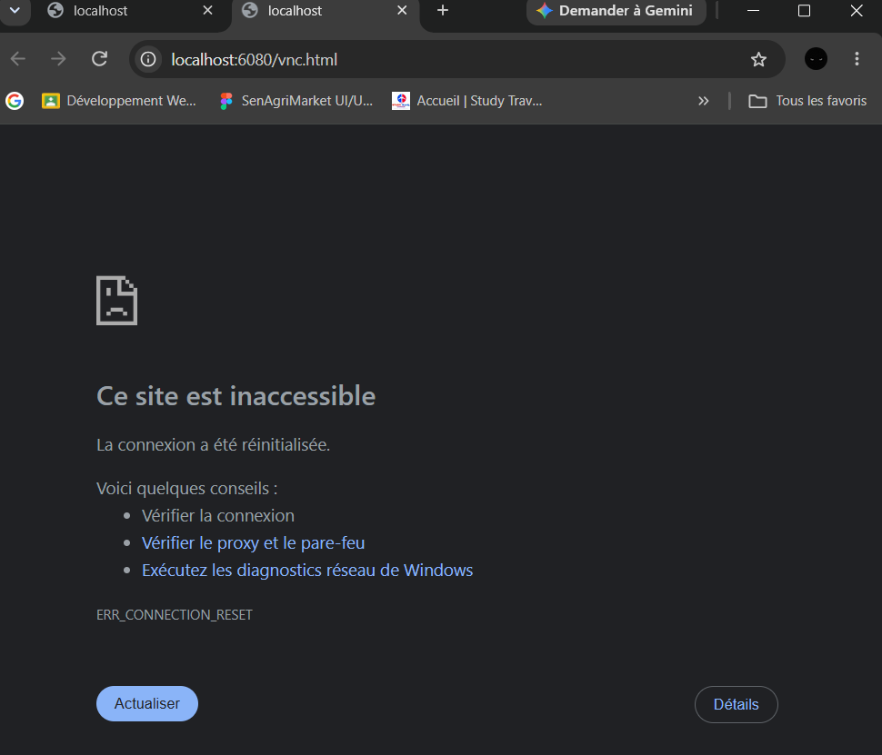

résultat des logs depuis ssh

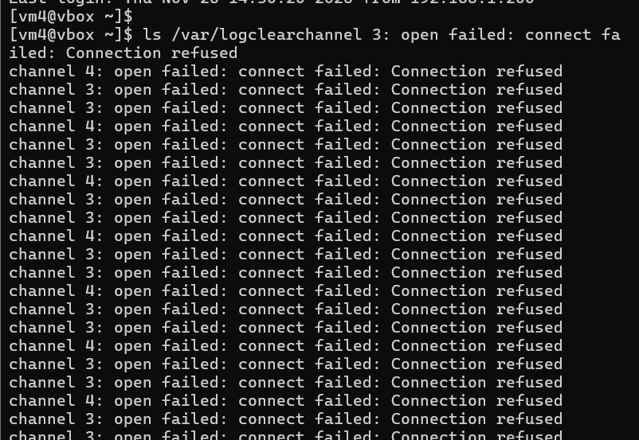

**Explication.** Ce résultat est normal compte tenu de la façon dont les services ont été lancés dans ce TP :

- **Le serveur VNC** a été démarré à la main avec `vncserver :1`. Cette commande crée une session qui vit tant que la machine est allumée ; à l'arrêt, le processus `Xvnc` disparaît et rien ne le recrée au démarrage. L'avertissement affiché à chaque lancement le rappelle : le script `vncserver` est déprécié et remplacé par une unité systemd.
- **noVNC** a été lancé avec `./utils/novnc_proxy --vnc localhost:5901` dans un terminal. C'est un processus au premier plan, qui s'arrête dès que le terminal est fermé ou que la machine redémarre. Il ne s'agit pas d'un service.
- **Les deux sont liés** : même si noVNC était relancé, le proxy n'aurait rien vers quoi rediriger (`localhost:5901`) tant que la session VNC n'existe pas.
- **Le tunnel SSH** se trouve sur le client. Il est coupé quand la machine serveur s'arrête et doit être recréé avec la commande `ssh -L 6080:localhost:6080 vm4@192.168.1.210`.

**Remise en marche manuelle.** Après un redémarrage, il faut donc refaire, dans cet ordre : `vncserver :1` sur le serveur, `./utils/novnc_proxy --vnc localhost:5901` dans `/opt/noVNC`, puis le tunnel SSH sur le client. On peut contrôler que les deux ports sont bien en écoute avec :

```bash
ss -tlnp | grep -E '5901|6080'
```

### 3. Questions de réflexion

**Quelle est l'utilité de Websockify dans l'architecture de noVNC ?**

Le serveur VNC parle le protocole RFB sur une connexion TCP brute (port 5901), alors qu'un navigateur ne peut communiquer qu'en HTTP et en WebSocket : il ne peut pas ouvrir lui-même de socket TCP vers 5901. Websockify sert de traducteur : il reçoit les connexions WebSocket du navigateur sur le port 6080 et relaie les données en TCP vers `localhost:5901`, et inversement. Dans notre TP, le script `novnc_proxy` lance aussi un petit serveur web qui distribue les fichiers noVNC (`vnc.html`, `app`, `core`) depuis `/opt/noVNC` : la sortie du terminal l'indique (« proxying from :6080 to localhost:5901 »). Sans websockify, la page noVNC se chargerait mais ne pourrait pas se connecter au bureau.

**Quelles sont les différences entre noVNC et les autres clients VNC standards ?**

- **Nature du client :** noVNC est un client écrit en JavaScript/HTML5 qui s'exécute dans le navigateur (affichage dans un canvas). Les clients standards (RealVNC Viewer utilisé dans la partie 2, TigerVNC Viewer, Remmina) sont des applications natives à installer sur chaque système.
- **Installation :** noVNC ne demande rien sur le poste client (un navigateur suffit, y compris sur mobile) ; un client standard doit être téléchargé et installé.
- **Protocole et port :** un client standard se connecte directement au port TCP 5901 du serveur. noVNC passe par WebSocket sur le port 6080 et nécessite le composant intermédiaire websockify.
- **Fonctions :** les clients natifs offrent plus d'options (choix des encodages, négociation du chiffrement, carnet d'adresses, transfert de fichiers selon le client). noVNC propose l'essentiel dans un panneau latéral (plein écran, paramètres, presse-papiers).

**Quels sont les avantages et inconvénients de noVNC par rapport à une application VNC native ?**

Avantages, constatés pendant le TP :

- **Aucune installation côté client :** le bureau s'est ouvert depuis Chrome sur `localhost:6080`, alors que la partie 2 a nécessité l'installation de RealVNC Viewer.
- **Indépendant du système :** il fonctionne sur Windows, Linux, macOS, et même sur un téléphone, avec n'importe quel navigateur récent. C'est utile sur un poste où l'on ne peut pas installer de logiciel.
- **Un seul port à exposer :** le port 6080 (HTTP/WebSocket), plus facile à faire passer à travers un pare-feu ou un proxy que 5901, et facile à intégrer dans un portail web.

Inconvénients, également constatés ou directement liés à notre montage :

- **Composants supplémentaires à installer et maintenir :** git, python3-pip, websockify et noVNC, alors qu'un client natif se contente d'un serveur VNC. Il y a aussi plus de choses qui peuvent tomber en panne : après le redémarrage, il a fallu relancer VNC, noVNC et le tunnel, soit trois éléments au lieu d'un seul.
- **Pas de chiffrement par défaut :** la sortie de `novnc_proxy` signale « No SSL/TLS support (no cert file) ». Sans certificat (`self.pem`), les identifiants et l'écran circulent en clair ; il faut donc ajouter un tunnel SSH ou un certificat TLS. Le client natif connecté sans tunnel affichait lui aussi l'avertissement de connexion non chiffrée (partie 2), mais pour le client RealVNC le chiffrement peut être négocié.
- **Moins performant et moins complet :** l'affichage passe par le navigateur, avec un traitement JavaScript et une couche de conversion supplémentaire, ce qui entraîne plus de latence et plus de consommation de CPU qu'un client natif. Certaines combinaisons de touches (Ctrl+Alt+Suppr, Alt+Tab, raccourcis du navigateur) et l'accès au presse-papiers sont limités par le navigateur, et il n'y a pas de transfert de fichiers intégré.
- **Surface d'attaque plus grande :** un service web de plus écoute sur le serveur (port 6080). Dans notre montage, il n'est utilisé que via le tunnel SSH.

En résumé, noVNC est idéal pour un accès ponctuel et pratique depuis n'importe quel poste, tandis qu'un client VNC natif reste préférable pour un usage quotidien exigeant de bonnes performances et une meilleure intégration.

---

## Conclusion

Ce TP a permis d'installer et de configurer un serveur VNC (TigerVNC) avec un bureau XFCE sur une machine RHEL 9, de s'y connecter depuis un client Windows avec RealVNC Viewer, puis de sécuriser la connexion à l'aide d'un tunnel SSH. Le test (création d'un dossier et d'un fichier depuis la session distante) a confirmé que le contrôle à distance fonctionne. La connexion directe n'étant pas chiffrée, le passage par le tunnel SSH est indispensable pour protéger le mot de passe et les données échangées.

La seconde partie a permis de rendre le même bureau accessible depuis un navigateur grâce à noVNC et websockify, sans client à installer sur le poste distant. Le service noVNC, lancé sans certificat, n'est pas chiffré : il est donc utilisé à travers un tunnel SSH. Le test de redémarrage a montré que VNC et noVNC, lancés manuellement, ne se relancent pas seuls : pour un usage durable, il faut les déclarer comme services systemd.
